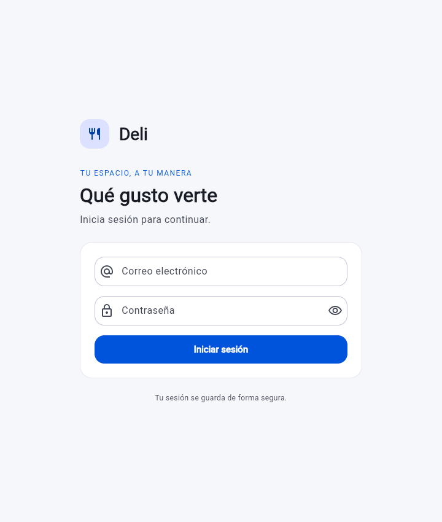

# Flutter Starter · Deli

Base Flutter para aplicaciones con autenticación REST. Incluye inicio de sesión, restauración de sesión, almacenamiento seguro del token y preferencias de idioma, tema y paleta.

Para explorar la interfaz, ejecuta la app en Chrome con la configuración de la sección siguiente. La pantalla de inicio de sesión sirve como punto de partida. La navegación a Home requiere una API compatible y credenciales válidas.



## Ejecutar

SDK utilizado: Flutter 3.47.7 / Dart 3.13.5. Instala ese SDK y añade su directorio `bin` al PATH.

Desde esta carpeta:

```powershell
flutter pub get
dart run build_runner build
flutter run --dart-define=API_BASE_URL=http://10.0.2.2:8000/api/v1/
```

Este ejemplo usa un emulador Android estándar. En VS Code, selecciona el emulador y la configuración **Deli · Android emulator** de .vscode/launch.json. Esta configuración pasa la URL explícitamente. Si ejecutas main.dart sin argumentos, Android debug usa automáticamente 10.0.2.2 para llegar al equipo anfitrión; Windows y web usan localhost. API_BASE_URL siempre tiene prioridad sobre esos valores de desarrollo.

Para Windows:

```powershell
flutter run -d windows --dart-define=API_BASE_URL=http://localhost:8000/api/v1/
```

Para web:

```powershell
flutter run -d chrome --web-port=5173 --dart-define=API_BASE_URL=http://localhost:8000/api/v1/
```

Mantén el mismo origen y puerto web para recuperar el almacenamiento en reinicios. En navegador, el backend debe permitir el origen mediante CORS. El almacenamiento seguro web requiere HTTPS o localhost; no equivale a un almacén de credenciales nativo.

### API por entorno

API_BASE_URL se centraliza en lib/core/config/app_config.dart y se proporciona con --dart-define. No contiene credenciales.

| Plataforma | URL de desarrollo |
| --- | --- |
| Windows / navegador en el equipo del backend | http://localhost:8000/api/v1/ |
| Emulador Android estándar | http://10.0.2.2:8000/api/v1/ |
| Android por USB con adb reverse tcp:8000 tcp:8000 | http://127.0.0.1:8000/api/v1/ |
| Dispositivo físico por LAN | http://IP_DEL_PC:8000/api/v1/ |
| Producción | https://TU_DOMINIO/api/v1/ |

Para LAN, el backend Docker debe escuchar en la IP LAN del equipo mediante APP_BIND_IP, y el firewall debe permitir el acceso desde el dispositivo. El backend actual solo publica en 127.0.0.1; no basta con cambiar la URL de Flutter. Con adb reverse puedes conservar el backend en localhost.

Android debug permite HTTP local; release conserva la política predeterminada de tráfico seguro. Android incluye permiso INTERNET y desactiva la copia automática de datos para evitar restauraciones incompatibles del almacén seguro. Para iOS usa HTTPS con certificado válido o configura excepciones de desarrollo específicas en tu entorno; no se agregó una excepción HTTP global de producción.

### Android NDK

El proyecto fija NDK 28.2.13676358, la versión solicitada por este SDK de Flutter. Se instaló correctamente mediante Gradle junto con Android SDK Platform 36; el sdkmanager del equipo redirigía a una CLI que no reconocía el nombre del paquete. Conserva NDK 28.2.13676358 instalado en Android Studio → SDK Manager → SDK Tools → Show Package Details → NDK (Side by side), también en CI. No es necesario reemplazar el NDK 30 de otros proyectos.

## Estructura

```text
lib/
  app/                          # GetMaterialApp, rutas, guard y bindings
  core/
    config/                     # URL de API por entorno
    localization/               # es, en, fr, pt
    network/                    # Dio, encabezados y errores tipados
    settings/                   # Preferencias reactivas
    storage/                    # GetStorage y token seguro
    theme/                      # Paletas, ThemeData, extensión y espaciado
  features/
    auth/
      domain/                   # AuthUser y contrato AuthRepository
      data/
        models/                 # Freezed + JSON, sin lógica de UI
        sources/                # Contrato HTTP del backend
        repositories/           # Sesión y caché local
      presentation/
        controllers/            # Login y sesión
        views/                  # Login
    home/presentation/
      controllers/              # Selección inferior
      views/                    # Home y destinos provisionales
      widgets/                  # Panel de preferencias
  shared/widgets/               # Tarjetas y mensajes reutilizables
```

Las vistas solo interactúan con controladores. Los controladores delegan la autenticación al contrato de repositorio. Dio, almacenamiento y conversión JSON quedan fuera de las vistas. Los bindings son pequeños y están centralizados en app/routes.dart; no se crearon directorios vacíos ni casos de uso sin reglas de negocio.

## Dependencias

| Paquete | Uso |
| --- | --- |
| get | Estado, rutas, guard e inyección de dependencias |
| get_storage | Idioma, tema, paleta y caché no secreta de usuario |
| dio | HTTP centralizado, timeouts y encabezado Bearer |
| flutter_secure_storage | Token detrás de TokenStore |
| freezed_annotation / freezed | Modelos inmutables, copyWith y comparación por valores |
| json_annotation / json_serializable | Serialización de request, response y usuario anidado |
| build_runner | Generación de archivos, sin edición manual |
| intl / flutter_localizations | Fechas, números y componentes Material localizados |

Se usan los iconos y componentes Material incluidos con Flutter: no fue necesaria otra biblioteca visual ni de iconos. ContentCard, InlineMessage, estilos del tema y los modelos generados reducen repetición; no se afirma un porcentaje de reducción sin una base comparable.

## Flujo de sesión

1. Inicializar GetStorage y recuperar preferencias antes de runApp.
2. Leer token del almacenamiento seguro y caché del usuario.
3. Si hay token, consultar GET profile con Bearer. Su respuesta real es data con role singular; login devuelve user con roles. La conversión se hace en la fuente remota.
4. Con servidor disponible, restaurar el perfil validado. Con error de red/servidor y caché válida, mostrar Home con sesión pendiente de confirmación y acción Reintentar. Sin caché no se inventa un perfil: se muestra login y se conserva el token para un intento posterior.
5. POST login envía exclusivamente email y password, sin identificador telefónico adicional. Validar respuesta completa antes de persistir.
6. Tras login exitoso, guardar token separado del perfil y navegar con offAllNamed para retirar login del historial.
7. Un 401 autenticado limpia sesión y vuelve al login. Un 401 del login muestra credenciales incorrectas y no activa el manejador de expiración de sesión. Un error de red no borra la sesión.
8. Cerrar sesión elimina token y caché, descarta la navegación y conserva preferencias. El cierre de esta primera UI es local: no renueva tokens ni invoca logout remoto. El backend sí dispone de POST logout para una ampliación posterior; el token local eliminado no se revoca por esa acción de UI.

No se guardan contraseñas. No hay credenciales precargadas, logger HTTP ni impresión de tokens. Se desactivó el toString generado para los modelos que contienen contraseña o token. Las respuestas de error se mapean por HTTP a mensajes traducidos; no se intenta leer user/token de una respuesta fallida ni se muestran excepciones internas.

## UI y personalización

Solo hay login y Home. La barra inferior tiene exactamente cuatro botones: Inicio y tres destinos provisionales sin funcionalidad de negocio. IndexedStack conserva la vista Home y su posición al cambiar de selección. No se agregaron registro, recuperación ni pantallas de negocio adicionales.

Home incluye información del usuario, estado de sesión, logout y un panel para:
- Idioma español, inglés, francés o portugués.
- Apariencia de sistema, clara u oscura.
- Cinco paletas: océano (azul), bosque (esmeralda), frambuesa, violeta y coral. Todas tienen variantes claras y oscuras, superficies neutras y controles con acentos coordinados.

El idioma del dispositivo se detecta al primer inicio y usa español como respaldo. AppTranslations centraliza textos y parámetros; los plurales de roles y los formatos de fecha/número respetan el idioma activo. Las preferencias persisten en GetStorage y se aplican a login, Home y navegación.

## Ampliar

- **Funcionalidad:** agrega features/nombre con domain, data y presentation según las responsabilidades necesarias. Define contrato, implementación y controlador; registra ruta/binding en app/routes.dart. Reutiliza servicios core y widgets shared.
- **Modelo:** crea una clase Freezed en data/models con factory fromJson y las directivas part. Regenera con dart run build_runner build. build.yaml activa explicit_to_json para objetos anidados.
- **Paleta:** añade un valor a AppPalette con identificador estable y clave traducida. AppTheme construye claro/oscuro automáticamente desde la semilla. Para nuevos colores semánticos amplía StatusColors; no insertes hexadecimales en las vistas.
- **Idioma:** añade código/nombre y columna al catálogo AppTranslations, Locale a supportedLocales y datos intl al arranque. Añade cada texto a todos los idiomas; la prueba detecta claves faltantes.
- **Regla de negocio:** añade un caso de uso cuando exista coordinación/reglas suficientes para justificarlo, evitando envoltorios que solo reenvían una llamada.

## Comprobaciones

```powershell
dart format lib test
dart run build_runner build
flutter analyze
flutter test
flutter build apk --debug --dart-define=API_BASE_URL=http://10.0.2.2:8000/api/v1/
```

Pruebas de modelos, contrato de login/profile, sesión restaurada, caché sin conexión, 401, timeouts, errores de servidor, respuestas incompletas, validaciones UI, bloqueo de envíos duplicados, cuatro destinos, logout sin retorno con Atrás, idiomas y persistencia de preferencias al recrear controladores.

La prueba HTTP real se realizó contra el backend local con las credenciales de desarrollo proporcionadas por el usuario; no se incorporaron a archivos. Login y profile respondieron correctamente y se revocó el token de prueba mediante logout.

Los tests de sesión y UI usan almacenamiento en memoria y adaptadores HTTP de prueba. No sustituyen una comprobación del almacén seguro tras cerrar/reabrir la app en un dispositivo real. iOS requiere macOS para compilar y validar Keychain. La compilación y validación Android se registra en docs/VALIDACION.md.

Referencias: [Freezed](https://pub.dev/packages/freezed), [GetStorage](https://pub.dev/packages/get_storage), [almacenamiento seguro y requisitos por plataforma](https://pub.dev/packages/flutter_secure_storage), [NDK lado a lado](https://developer.android.com/studio/projects/install-ndk).

## Lectura de modelos

Consulta [la guía de modelos](docs/MODELOS.md). VS Code agrupa los archivos .freezed.dart y .g.dart debajo de su modelo fuente. Los archivos generados no se editan manualmente.
